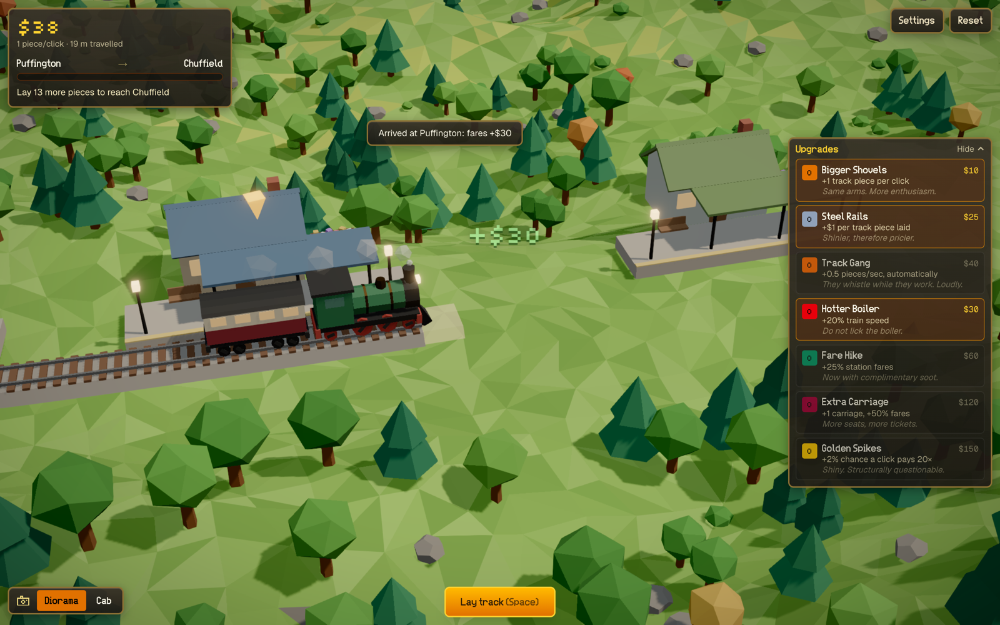

# Model Trainz

A cozy 3D incremental game about building a railway, one piece of track at a time. It runs
entirely in the browser.



## Gameplay

Your little steam train waits at a station. Between it and the next station there's nothing but
countryside, so it's up to you to build the line.

- **Lay track.** Click anywhere on the scene, press or hold **Space**, or use the **Lay track**
  button. Each click lays track in front of the train; hold to keep going.
- **Run the line.** When the track reaches the next station the train departs, chuffs along the
  new stretch and collects fares when it pulls in. Then the next leg begins.
- **Upgrade.** Spend coins in the **Upgrades** panel on the right (collapse it with **Hide/Show**):

  | Upgrade        | Effect                               |
  | -------------- | ------------------------------------ |
  | Bigger Shovels | +1 track piece per click             |
  | Steel Rails    | +$1 for every track piece laid       |
  | Track Gang     | +0.5 pieces/sec, laid automatically  |
  | Hotter Boiler  | +20% train speed                     |
  | Fare Hike      | +25% station fares                   |
  | Extra Carriage | +1 carriage on the train, +50% fares |
  | Golden Spikes  | +2% chance that a click pays out 20× |

- **Visit the Depot.** The **Depot** tab next to Upgrades sells new train sets. The one in service
  sets the train's top speed and fares; once bought you can switch between them for free.

  | Train set         | Price | Locomotive + coaches             | Bonus                  |
  | ----------------- | ----- | -------------------------------- | ---------------------- |
  | Heritage Steam    | Free  | Steam tank engine + teak coaches | —                      |
  | Evergreen Express | $50K  | Mainline diesel + modern coaches | +50% speed, +50% fares |

- **Pick up where you left off.** Your game pauses when you close the tab. Next time, the start
  screen welcomes you back with a **Continue** button; use your Game ID (in the **Game** panel) to
  carry on from another device.
- **Pick a view.** Press **V** (or use the toggle bottom left) to switch between the overhead
  **Diorama** and the first-person **Cab**. Scroll to zoom the diorama; in the cab, drag or use the
  arrow keys to look around and **C** to re-centre.
- **Settings** (top right) cover sound, volume, graphics quality (Auto, Low, Medium, High, Ultra)
  and the full list of controls.

Progress is saved automatically in your browser.

## Toolstack

| Area                | Tools                                                                                        |
| ------------------- | -------------------------------------------------------------------------------------------- |
| Framework           | [Next.js](https://nextjs.org) 16 (App Router), React 19, TypeScript (strict)                 |
| 3D rendering        | [three.js](https://threejs.org) via React Three Fiber and drei                               |
| Post-processing     | `postprocessing` + `@react-three/postprocessing` (bloom, SSAO, tone mapping, SMAA, vignette) |
| World generation    | `simplex-noise` terrain, meshed in Web Workers                                               |
| State               | Zustand                                                                                      |
| UI                  | Tailwind CSS 4                                                                               |
| Audio               | Web Audio API (all sound effects synthesised at runtime)                                     |
| Testing and quality | Vitest, Playwright, ESLint, Prettier                                                         |
| Package manager     | pnpm                                                                                         |

All models, textures and sounds are generated procedurally; there are no external art assets.

## Getting started

### Run locally

You need Node.js 20 or newer and pnpm. The pnpm version is pinned in `package.json`; run
`corepack enable` once to use it automatically.

```bash
pnpm install
pnpm dev
```

Open [http://localhost:3000](http://localhost:3000).

### Useful scripts

| Script            | What it does                                                 |
| ----------------- | ------------------------------------------------------------ |
| `pnpm build`      | Production build                                             |
| `pnpm start`      | Serve the production build                                   |
| `pnpm typecheck`  | Type-check with `tsc`                                        |
| `pnpm lint`       | ESLint (zero warnings allowed)                               |
| `pnpm test`       | Unit tests (Vitest)                                          |
| `pnpm test:e2e`   | Browser smoke tests (Playwright)                             |
| `pnpm screenshot` | Re-capture `docs/screenshot.png` while `pnpm dev` is running |
| `pnpm format`     | Format with Prettier                                         |

Stop `pnpm dev` before running `pnpm build`; both write to `.next/`.

### Deploy to Vercel

1. Push the repository to GitHub, GitLab or Bitbucket and import it at
   [vercel.com/new](https://vercel.com/new).
2. Keep the detected Next.js defaults.
3. Add the environment variable `ENABLE_EXPERIMENTAL_COREPACK=1` so Vercel uses the pinned pnpm
   version.
4. If you use a custom domain, also set `NEXT_PUBLIC_SITE_URL` (for example
   `https://modeltrainz.example`) so social preview images link to it.
5. For online saves (Game IDs that work on any device), set `SUPABASE_URL` and
   `SUPABASE_SECRET_KEY` from a Supabase project with a `games` table (see
   `docs/DECISIONS.md`, "Players and Game IDs"). Without them, saves stay in the browser.
